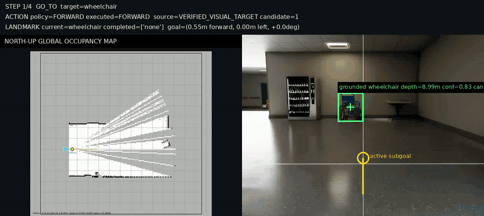

CAPTAINav: Confidence-Gated Semantic Anchors and Primitive-Aligned Typed Instruction Navigation
=======


**A Hybrid Navigation Method Based on Confidence-Gated Semantic Anchors, Typed Instruction Execution, and Primitive-Aligned VLM Search.**

CAPTAINav connects natural-language instructions, RGB-D perception, LiDAR mapping, open-vocabulary grounding, VLM reasoning, and low-level wheel/steering control into a runnable closed-loop navigation stack.

| | |
|---|---|
| Simulator | Isaac Sim |
| Python | python3.11 |
| Robots | AGX 4WS / Unitree G1 29-DoF |
| Policy | VLM-guided VLN prototype |
| Actions | Discrete atomic primitives |


## Demo

> **Instruction:** "You are currently in the hospital lobby. You need to go straight to find the wheelchair, then turn left, and in front of the stairs, turn right to find the yellow warning sign and stop in front of it."

[](https://raw.githubusercontent.com/Aduo666/VLM-NAV/main/docs/assets/display.mp4)

Click it to open the full-resolution H.264 recording.

## Features

- **Isaac Sim 5.1**: scene USD loading, robot profiles, cameras, LiDAR, viewport setup.
- **Swappable locomotion backends**: the AGX uses the existing 4WS joint controller; Unitree G1 uses a 480-input/29-output TorchScript locomotion policy on CPU. Both expose FORWARD / TURN_LEFT / TURN_RIGHT / STOP primitives with odometry-based completion.
- **Semantic grounding + memory**: local GroundingDINO keeps multiple proposals, preserves instance continuity, and sends only low-confidence crops to the VLM for verification; confirmed landmark anchors remain persistent.
- **Typed instruction graph**: one startup parse separates trusted scene context from executable `GO_TO`, `REGION_TRANSITION`, and `TURN` steps; validated plans are cached by instruction and schema version.
- **Aligned action representation**: at stopped decision keyframes, the VLM chooses exactly one safe candidate outcome that maps one-to-one to TURN_LEFT / FORWARD / TURN_RIGHT.
- **Region-aware execution**: room transitions require consistent visual region evidence, odometry displacement, and a topology-node change rather than keyword matching alone.
- **Search / approach separation**: VLM exploration is used while a landmark is unknown; fresh verified image evidence directly approaches the target, while a confirmed off-screen anchor is followed through occupancy-grid A* with bounded local detours when the direct route is blocked.
- **Fast primitive execution**: during an atomic action, expensive decision-time perception is skipped; odometry, depth safety, drive control, and LiDAR/map updates remain active.
- **Local and evaluation flows**: normal debugging uses `debug/local` and `logs/nav_latest.log`; dataset evaluation uses `debug/eval` plus eval outputs.


## Environment Setup

The project now uses only the conda / pip Isaac Sim workflow. The project environment name is `vlmnav`.

### 1. Create The Conda Environment

Isaac Sim 5.1 uses Python 3.11.

```bash
conda create -n vlmnav python=3.11 -y
conda activate vlmnav
python -m pip install --upgrade pip setuptools wheel
```

### 2. Install Isaac Sim And Core Dependencies

```bash
pip install -r requirements.txt
```

`requirements.txt` contains:

- `isaacsim[all,extscache]==5.1.0`
- `numpy==1.26.0`
- `PyYAML==6.0.2`
- `Pillow==11.3.0`
- `opencv-contrib-python-headless==4.11.0.86`

The NVIDIA PyPI index is already included in `requirements.txt`.

### 3. Configure SiliconFlow / VLM API

```bash
export SILICONFLOW_API_KEY="your_api_key"
```

The default model and API endpoint are configured in `configs/default.yaml`.

### 4. Install Local GroundingDINO

GroundingDINO is required by the current main navigation method. It keeps up to five distinct open-vocabulary proposals after NMS. High-confidence detections use short temporal/geometric confirmation; lower-confidence detections are verified from a clean object crop by the VLM and require a second consistent observation from a different viewpoint. The navigation path does not fall back to VLM-generated boxes.

```bash
conda activate vlmnav

# If torch / torchvision are missing in your conda environment, install a CUDA build first.
pip install torch==2.7.0 torchvision==0.22.0 --index-url https://download.pytorch.org/whl/cu128

# Clone / patch GroundingDINO and install its Python dependencies.
bash scripts/setup_grounded_sam_local.sh
```

Required model files:

- `third_party/GroundingDINO/`
- `weights/grounded_sam/GroundingDINO_SwinT_OGC.py`
- `weights/grounded_sam/groundingdino_swint_ogc.pth`
- `weights/grounded_sam/bert-base-uncased/config.json` and the accompanying local BERT snapshot

`scripts/setup_grounded_sam_local.sh` prints symlink commands if you already have the CA-Nav weights locally.

## Run

### Local Navigation

```bash
conda activate vlmnav
export SILICONFLOW_API_KEY="your_api_key"

# Run the default task from configs/default.yaml / configs/instructions.json.
bash scripts/run_nav.sh

# Run a named task.
bash scripts/run_nav.sh --task hospital_001

# List available tasks.
bash scripts/run_nav.sh --list-tasks

# Headless mode.
bash scripts/run_nav.sh --headless
```

The launch scripts use the currently active conda environment. If you need to launch from another shell without activating first, override the environment explicitly:

```bash
CONDA_ENV_NAME=vlmnav bash scripts/run_nav.sh
```

### Robot Profiles

Robot selection is intentionally a single configuration switch in `configs/default.yaml`:

```yaml
robot:
  profile: "agx"  # or "unitree_g1_29dof"
```

Robot-specific assets, sensor prims, simulation rates, geometry, safety limits, primitive parameters, and controller settings live only in:

```text
configs/robots/agx.yaml
configs/robots/unitree_g1_29dof.yaml
```

The G1 profile expects these local files:

```text
src/unitree_model/g1_29dof/
  policy/policy.pt
  policy/deploy.yaml
  usd/g1_29dof_rev_1_0.usd
  usd/configuration/g1_29dof_rev_1_0_base.usd
  usd/configuration/g1_29dof_rev_1_0_physics.usd
  usd/configuration/g1_29dof_rev_1_0_sensor.usd
```

Its resolved sensor prims are strict: missing paths terminate startup instead of creating fallback sensors.

```text
/World/Robot/g1_29dof_rev_1_0/torso_link/d435_link/Camera
/World/Robot/g1_29dof_rev_1_0/pelvis/observeCamera
/World/Robot/g1_29dof_rev_1_0/pelvis/Lidar
```

Task files continue to provide `x`, `y`, and yaw. Spawn height is owned by the robot profile (`0.0 m` for AGX and `0.8 m` for G1), so tasks do not need robot-specific z values. G1 uses active zero-command balance for STOP and terminates navigation on a confirmed fall while keeping the simulator open.

Before running VLN with G1, validate the locomotion policy in the isolated interactive test:

```bash
conda activate vlmnav
bash scripts/run_g1_policy_test.sh
```

The test always loads `unitree_g1_29dof`, regardless of the profile selected for navigation. It creates only a flat ground plane, light, G1, and the existing TorchScript policy. Use the arrow keys or panel buttons for FORWARD, BACKWARD, TURN_LEFT, and TURN_RIGHT; releasing every direction commands active STOP. Its fixed turn speed is the same `turn_command * waypoint_turn_speed_scale` used by VLN. The panel reports actual body velocity, pelvis height and attitude, policy action magnitude, and joint tracking error.

Forward and backward commands are clamped to the policy ranges exported in `deploy.yaml`. Turning uses the robot profile's `turn_command`, so the test and VLN send the same configured angular velocity. A confirmed fall triggers a full simulation and policy-state reset after 0.5 seconds. Three automatic resets are allowed; after a fourth fall, use the panel's manual reset button.

For G1 mapping, LiDAR points are projected through the live sensor pose into a yaw-level pelvis frame before entering the global map. Floor and ceiling returns caused by body tilt are rejected, static cells require evidence from multiple frames, and isolated free-space rays cannot erase a wall. Consistent contradictory free-space observations can still remove a false obstacle. This G1-only stabilization does not change the AGX mapping branch or visualization scale.

### Task Authoring Panel

```bash
conda activate vlmnav
bash scripts/run_task_editor.sh
```

This loads the configured scene and robot, then opens the in-simulator task editor panel for adding instructions to `configs/instructions.json`.

## Benchmark Evaluation

### InteriorNav

```bash
bash eval/interiornav/run.sh
SPLIT=val_unseen EPISODE_INDEX=0 bash eval/interiornav/run.sh
```

Data root: `/Data/qiang/interiornav_data`

### VLN-PE / R2R

```bash
bash eval/vlnpe/run.sh
SPLIT=val_unseen EPISODE_INDEX=5 bash eval/vlnpe/run.sh
```

Data root: `/Data/qiang/InternData-N1/vln_pe`

Scene root: `/Data/qiang/mp3d_pe`

Each dataset has an adapter under `eval/<dataset>/adapter.py` that normalizes dataset episodes into the task format consumed by `nav.py`.

## Current Pipeline

```text
English language instruction
  -> one validated typed semantic graph (cached)
       scene context: localization evidence only
       route steps: GO_TO / REGION_TRANSITION / TURN
  -> RGB-D + LiDAR + odometry observation
  -> GO_TO: GroundingDINO proposal + VLM semantic verification
       visible target -> deterministic centering/approach
       confirmed off-screen anchor -> occupancy A*
       unknown target -> one VLM candidate choice at a stopped keyframe
  -> REGION_TRANSITION: candidate choice + region evidence
       complete only after semantic + odometry + topology agreement
  -> TURN: 15-degree corridor scan, stable early exit after 45 degrees,
           and best-heading recovery within a 105-degree bound
  -> robot-profile locomotion backend
       AGX: low-level 4WS joint controller
       G1: CPU TorchScript policy -> 29 joint position targets
```

During primitive execution, the loop does not request VLM decisions or run heavy grounding. It continues odometry completion, LiDAR hit/miss mapping, hard safety checks, and low-level control. A stopped decision keyframe permits at most one VLM request: semantic verification or candidate/region reasoning, never both.

The VLM input is intentionally split by role:

- A first-person candidate image for visual choice.
- Structured text for semantic map, landmark memory, obstacle distances, route context, and candidate action metadata.
- No raw occupancy image is sent to the VLM by default; occupancy visualization is mainly for human debugging.

Instruction parsing is fail-closed and runs before Isaac Sim starts. It uses a dedicated 90-second timeout, performs one parse request, deterministic schema validation, and at most one repair request. If neither produces a valid graph and no matching cache exists, navigation does not silently substitute a heuristic plan. Normal navigation requests continue using `llm.timeout_sec`.

## Key Configuration

All main configuration lives in `configs/default.yaml`.

```yaml
robot:
  profile: "agx"

llm:
  model_name: "Qwen/Qwen3-VL-30B-A3B-Instruct"
  api_base_url: "https://api.siliconflow.cn/v1"

target_grounding:
  enabled: true
  backend: "grounding_dino"
  grounding_dino_text_encoder_path: "weights/grounded_sam/bert-base-uncased"
  grounding_dino_max_detections: 5
  semantic_verification_enabled: true
  semantic_verification_min_confidence: 0.50
  semantic_verification_auto_accept_confidence: 0.75

landmark_tracker:
  confirm_confidence_threshold: 0.75
  confirm_min_observations: 2
  confirm_max_anchor_jump_m: 0.75

opennav:
  instruction_parse_max_tokens: 768
  instruction_parse_timeout_sec: 90
  instruction_cache_enabled: true
  instruction_cache_path: ".cache/instruction_plans.json"
  region_transition_min_displacement_m: 1.0
  region_transition_confirmations: 2
  region_transition_min_confidence: 0.55
  semantic_turn_min_yaw_deg: 45.0
  semantic_turn_max_yaw_deg: 105.0
  semantic_turn_max_primitives: 7
  semantic_turn_alignment_confirmations: 2
  visual_target_center_deadband_deg: 15.0
  arrival_distance_m: 2.0
  success_distance_m: 3.0

occupancy_grid:
  unknown_is_traversable: false

map_candidates:
  max_candidates: 3
```

Robot-specific primitive distances, turn angles, controller gains, timing, footprint, sensor paths, and physics rates are deliberately absent from `configs/default.yaml`; edit the selected file under `configs/robots/` instead.

Tasks are stored in `configs/instructions.json`. Each task can specify scene path, robot start pose, instruction text, and task metadata.

## Debug Outputs

```text
debug/
  local/
    vln_debug.png
    llm_request.png
    observevideos/observer_YYYYMMDD_HHMMSS.mp4
    videos/vln_debug_YYYYMMDD_HHMMSS.mp4
  eval/
    vln_debug.png
    videos/vln_debug_YYYYMMDD_HHMMSS.mp4

logs/
  vln.log
  last_candidate_choice_request.json
```

The console intentionally shows only navigation milestones: `[PLAN]`, `[NAV_STATE]`, `[LANDMARK_CONFIRMED]`, `[STEP_COMPLETE]`, `[SAFETY_HOLD]`, `[RECOVERY]`, `[ERROR]`, and `[ROUTE_COMPLETE]`. Full component logs are overwritten in `logs/vln.log` on each run. The human debug frame keeps its status bar outside the imagery: north-up global map on the left and uncropped first-person RGB on the right.

The observer-camera recording is captured automatically at 10 FPS from the configured robot observer camera. Its output is independent of the combined debug video and is saved under `debug/local/observevideos/`.

## Known Limitations

- VLM API latency is still the dominant delay between atomic primitives.
- GroundingDINO proposals can still be ambiguous; VLM verification reduces but cannot eliminate false positives.
- Detections without usable depth can guide image-space centering, but cannot create a world anchor or complete a landmark.
- Search decisions still depend on VLM quality, while confirmed-target approach is deterministic.
- The system is a research prototype, not a benchmark-final VLN agent.

## Research Context

CAPTAINav adapts ideas from VLN, ObjectNav, open-vocabulary grounding, semantic memory, and map-aware robot navigation into an Isaac Sim workflow with interchangeable wheeled and humanoid locomotion backends.

Inspired by R2R, VLN-CE, DUET, NavGPT, Open-Nav, Safe-VLN, and CA-Nav.
