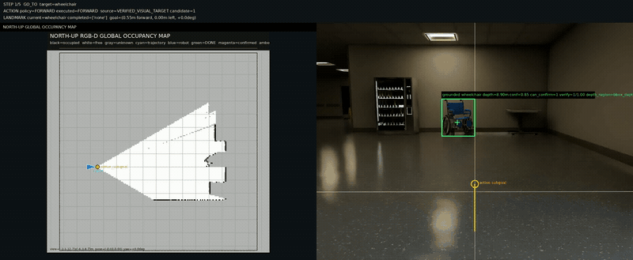
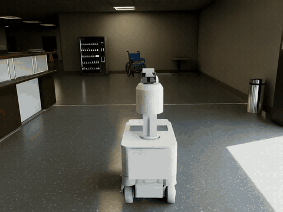
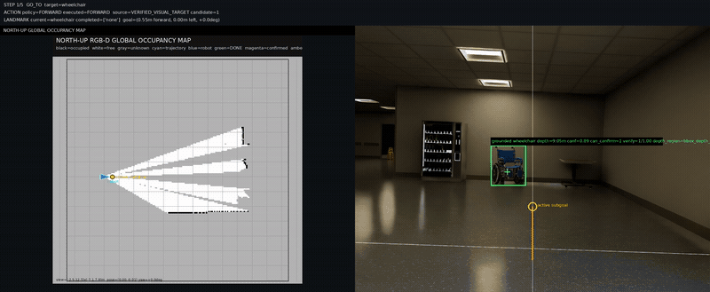
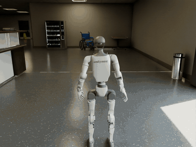

<div align="center">

# CAPTAINav

### Confidence-Gated Semantic Anchors and Primitive-Aligned Typed Instruction Navigation

Language-conditioned navigation in Isaac Sim with open-vocabulary grounding,
RGB-D geometry mapping, map-aware VLM reasoning, and robot-specific motion primitives.


</div>

## Demo

> **Instruction:** “You are currently in the hospital lobby. You need to go straight to
> find the wheelchair, then turn left, and in front of the stairs, turn right to find
> the yellow warning sign and stop in front of it.”

<div align="center">

<h3>AGX</h3>

<p><strong>First-Person Navigation View</strong></p>

<a href="docs/assets/agx_fv.mp4">
  
</a>

<p><strong>Observer View</strong></p>

<a href="docs/assets/agx_tv.mp4">
  
</a>

<h3>Unitree G1</h3>

<p><strong>First-Person Navigation View</strong></p>

<a href="docs/assets/g1_fv.mp4">
  
</a>

<p><strong>Observer View</strong></p>

<a href="docs/assets/g1_tv.mp4">
  
</a>

</div>


## Overview

CAPTAINav is a closed-loop VLN research prototype built on Isaac Sim 5.1. It combines:

- A validated typed instruction graph with `GO_TO`, `TURN`, and `REGION_TRANSITION`.
- Task-conditioned GroundingDINO boxes with confidence-gated VLM semantic verification.
- RGB-D global occupancy mapping, odometry, topology, and persistent landmark anchors.
- A clean first-person image plus structured textual map/candidate context for VLM decisions.
- Fixed semantic primitives shared by all robots: `FORWARD`, `TURN_LEFT`, and `TURN_RIGHT`.
- Robot-specific primitive realization and near-field safety for AGX and Unitree G1.
- Separate local development and dataset evaluation flows.


## Method

```text
English instruction
  -> one fail-closed instruction parse
  -> validated route graph: GO_TO / TURN / REGION_TRANSITION
  -> stopped decision keyframe
       RGB-D observation
       task-conditioned GroundingDINO proposals
       frontmost supported bbox-depth cluster and world projection
       semantic-anchor matching against physical occupancy surfaces
       VLM verification for ambiguous proposals
       RGB-D global occupancy + topological memory
       persistent semantic landmark anchors
  -> primitive-aligned candidate table
  -> VLM selects one valid candidate/action
  -> DepthSafetyMonitor checks front/left/right RGB-D clearance
  -> AGX 4WS controller or Unitree G1 locomotion policy
  -> odometry-verified primitive completion
  -> next decision keyframe
```

### Instruction Execution

The instruction parser runs before Isaac Sim starts. It returns a strict semantic graph:

- `GO_TO`: find and approach one grounded landmark.
- `TURN`: perform a bounded directional turn, optionally at a semantic trigger.
- `REGION_TRANSITION`: leave or enter a region using semantic, odometric, and topological evidence.

Objects that only describe the initial scene remain context evidence and are not silently promoted
to navigation targets. Invalid LLM JSON receives one repair request; if the repaired graph is still
invalid and no matching cache exists, startup fails explicitly.

### Perception And Memory

GroundingDINO is the semantic detector used by the navigation path. At stopped decision keyframes
it searches for the active route target using an open-vocabulary text query. Depth is estimated
from the nearest sufficiently supported depth layer inside the selected box rather than from the
whole-box median. This prevents a background wall from dominating the geometry of a thin object.
The resulting point is projected into the odometry frame. For `GO_TO`, CAPTAINav then searches a
bounded viewing cone in the non-inflated occupancy map and matches the raw semantic point to the
frontmost supported physical surface. The raw and matched anchors remain available in logs for
diagnosis. High-confidence proposals can be accepted directly; ambiguous proposals are verified
by the VLM using a clean crop.

Only the active target can become a route-completing landmark anchor after the existing identity,
depth, temporal-consistency, and geometry gates pass. RGB-D occupancy mapping remains geometric;
it is not populated by detector masks.

Confirmed anchors remain in the landmark map after leaving the camera view or completing a route
step. A detector proposal without reliable geometry may guide visual search, but it cannot create
a world anchor or complete a landmark by itself.

### Candidate Decisions

The VLM does not receive the occupancy image. Its navigation request contains:

- A clean, uncropped first-person RGB frame.
- The current typed route step and progress history.
- Structured landmark and topology summaries.
- Candidate heading, distance, map reachability, and repetition cost.
- A concise capability description for the selected robot profile.

The occupancy image remains available in `debug/local/vln_debug.png` for human inspection.

The global occupancy map, turn-clearance estimation, and near-field safety path all use calibrated
front-camera RGB-D data. Geometry is fused out to `10 m`; invalid and out-of-range depth samples
remain excluded.

### Robot-Aware Safety

`DepthSafetyMonitor` is the runtime obstacle-avoidance gate. It uses robust depth statistics from
front/left/right image regions:

- `FORWARD` stops at the robot profile's obstacle threshold and slows in the near field.
- `TURN_LEFT` checks front and left clearance.
- `TURN_RIGHT` checks front and right clearance.
- A short near-field memory prevents one missing sensor frame from immediately clearing an obstacle.
- Repeated safety holds cancel the active primitive and invoke the existing recovery path.

Robot profiles retain scalar stop, map-inflation, and candidate-corridor radii. The experimental
polygon footprint and full primitive sweep are not part of the active navigation path.

## Requirements

| Component | Version |
|---|---|
| OS | Linux x86_64 |
| Python | 3.11 |
| Isaac Sim | 5.1.0 pip distribution |
| CUDA GPU | Required for Isaac Sim and GroundingDINO |
| VLM API | OpenAI-compatible endpoint; SiliconFlow is configured by default |
| FFmpeg | Required with `libx264` for debug and observer video recording |

## Installation

### 1. Create The Environment

```bash
conda create -n vlmnav python=3.11 -y
conda activate vlmnav
python -m pip install --upgrade pip setuptools wheel
```

### 2. Install Isaac Sim And Core Dependencies

```bash
pip install -r requirements.txt
```

The requirements pin Isaac Sim 5.1 and `numpy==1.26.0`, together with Pillow, PyYAML, and OpenCV.

Install FFmpeg through the operating system and verify that H.264 encoding is available:

```bash
sudo apt-get install ffmpeg
ffmpeg -hide_banner -encoders | grep libx264
```

### 3. Install GroundingDINO

```bash
conda activate vlmnav
bash scripts/setup_grounding_dino_local.sh
```

The setup script installs the pinned GroundingDINO source and text encoder. Place or symlink the
model files into:

```text
weights/grounded_sam/GroundingDINO_SwinT_OGC.py
weights/grounded_sam/groundingdino_swint_ogc.pth
weights/grounded_sam/bert-base-uncased/
```

Model weights are ignored by Git and must not be placed in the repository root.

### 4. Configure The VLM

`configs/default.yaml` contains the endpoint, model name, and API-key field. The API key can also be
provided without editing the file:

```bash
export SILICONFLOW_API_KEY="your_api_key"
```

## Project Layout

```text
configs/
  default.yaml                 # Shared navigation, perception, mapping, and debug settings
  rgbd_mapping.yaml            # Standalone RGB-D geometry-map test
  robots/                      # Robot-specific assets, sensors, primitives, and controllers
scripts/
  run_nav.sh                   # Main navigation launcher
  run_rgbd_mapping.sh          # Isolated RGB-D geometry validation
  setup_grounding_dino_local.sh # GroundingDINO dependency setup
src/vln_nav/
  app/                         # Isaac Sim entry points
  control/                     # AGX and Unitree locomotion adapters
  navigation/                  # Instruction, perception, maps, policy, and safety
  runtime/                     # Strict config, robot profiles, and debug recording
  training/                    # Causal replay contracts, frontier labels, and dataset writers
training/                      # Independent expert replay collection and validation
third_party/                   # External source trees only; never model checkpoints
weights/grounded_sam/          # GroundingDINO checkpoints and text encoder, ignored by Git
debug/local/                   # Local debug image and timestamped videos
debug/eval/                    # Dataset evaluation artifacts
```

The main navigation path uses GroundingDINO for active-target perception. The standalone mapping
entry point exercises only RGB-D geometry projection and does not start the detector, VLM, or
navigation policy.

## Running

### Local Navigation

```bash
conda activate vlmnav
bash scripts/run_nav.sh
```

Common commands:

```bash
bash scripts/run_nav.sh --list-tasks
bash scripts/run_nav.sh --task hospital_002
bash scripts/run_nav.sh --headless
```

`scripts/run_nav.sh` uses the currently active conda environment. From an inactive shell:

```bash
CONDA_ENV_NAME=vlmnav bash scripts/run_nav.sh
```

### Robot Selection

Change only the profile name in `configs/default.yaml`:

```yaml
robot:
  profile: "agx"  # or "unitree_g1_29dof"
```

Robot-specific assets, sensors, physics rates, controller settings, primitive realization,
footprint, and safety limits live in:

```text
configs/robots/agx.yaml
configs/robots/unitree_g1_29dof.yaml
```

The semantic meaning of a primitive is shared, while its distance, angle, command magnitude,
timeout, and swept envelope come from the selected profile.

### G1 Policy Test

Validate the G1 TorchScript policy independently before running VLN:

```bash
bash scripts/run_g1_policy_test.sh
```

Use the arrow keys or panel buttons. Releasing all directions commands active zero-velocity
balance. The test automatically resets after a confirmed fall.

### RGB-D Geometry Mapping Test

The standalone AGX test builds a north-up global geometry map from the front RGB-D camera.
GroundingDINO, the VLM, and the navigation policy are not started, so geometry can be validated
independently.

```bash
bash scripts/run_rgbd_mapping.sh
```

Edit geometry and visualization parameters in `configs/rgbd_mapping.yaml`. Hold the arrow keys to
drive and release them to stop. The combined view is written to
`debug/local/rgbd_geometry_map.png`: the left panel is the north-up RGB-D occupancy map and the
right panel is the current front-camera image.

### Task Authoring

```bash
bash scripts/run_task_editor.sh
```

The Isaac Sim panel writes local tasks to `configs/instructions.json`. Task start `x`, `y`, and yaw
come from the task; spawn height comes from the selected robot profile.

## Evaluation

### InteriorNav

```bash
SPLIT=val_unseen EPISODE_INDEX=0 bash eval/interiornav/run.sh
```

### VLN-PE

```bash
SPLIT=val_unseen EPISODE_INDEX=0 bash eval/vlnpe/run.sh
```

Dataset adapters normalize source episodes into `eval/current_episode.json`. Evaluation artifacts
are written under `debug/eval/`, including a structured result JSON for each episode.

## Training Data

The first learned-policy milestone is an independent expert replay dataset, not online traces from
the current navigation policy. InteriorNav `train` routes are replayed with the calibrated AGX
front RGB-D camera while physics is paused. The collector builds causal partial maps and semantic
tracks, then labels instruction progress and persistent frontiers using the privileged future
route.

Training records expose two strict model views: `ProgressTrainingView` contains causal instruction,
RGB history and executed motion, while `SpatialSubgoalTrainingView` contains causal map tensors,
semantic tracks and reachable frontiers. Their supervision stays separate from both observations,
and `DebugOracle` retains future-route evidence for auditing only. `val_seen` and `val_unseen` are
rejected by the collector and remain evaluation-only splits.

```bash
SPLIT=train EPISODE_INDEX=0 bash training/scripts/collect_interiornav.sh
PYTHONPATH=src python training/scripts/validate_expert_replay.py --split train --episode-index 0
```

This stage freezes and validates the data contract only; model training and runtime policy
integration are intentionally not enabled yet. See [training/README.md](training/README.md) for
the V3 schema, fixed-scale timeline audit, quality report, output layout and small-batch collection
commands. Generated data is
written under `/Data/qiang/data/CAPTAINav/expert_replay` so large RGB-D datasets do not consume the
project or Home filesystem.

## Configuration

`configs/default.yaml` is a complete strict configuration. A custom YAML may contain only the
fields it overrides; it is deep-merged with the default file. Unknown fields are fatal instead of
being silently ignored.

```yaml
robot:
  profile: "unitree_g1_29dof"

scene:
  usd_path: "usd/hospital.usd"
  robot_start_xy_m: [1.5, 4.0]

llm:
  model_name: "Qwen/Qwen3-VL-30B-A3B-Instruct"
  timeout_sec: 30

perception:
  grounding:
    call_period_sec: 0.10
    detector:
      repo_path: "third_party/GroundingDINO"
      checkpoint_path: "weights/grounded_sam/groundingdino_swint_ogc.pth"
      box_threshold: 0.45

navigation:
  progress:
    landmark_clearance_m: 1.0
    final_success_clearance_m: 2.0
```

Physical geometry and primitive parameters must be edited in the robot profile, not duplicated in
the global configuration.

## Outputs

```text
debug/
  local/
    vln_debug.png
    observevideos/observer_<timestamp>.mp4
    videos/vln_debug_<timestamp>.mp4
  eval/
    vln_debug.png
    videos/vln_debug_<timestamp>.mp4
    results/<episode>_<timestamp>.json

logs/
  nav_latest.log
  vln.log
```

`nav_latest.log` is the complete launcher/Isaac console capture. `vln.log` contains the CAPTAINav
logger stream. Both are overwritten on the next local run.

## Tests

Pure-code tests do not start Isaac Sim:

```bash
PYTHONPATH=src python -m unittest discover -s tests -v
```

They cover instruction validation, robot profiles, bbox-aware depth, spatial projection, landmark evidence,
semantic turns, occupancy behavior, and robot-specific primitive safety.

## Limitations

- VLM latency remains the main delay between decision keyframes.
- Open-vocabulary grounding boxes can still be ambiguous despite temporal evidence and crop verification.
- World anchors depend on camera calibration, RGB-D surface support, and odometry consistency.
- The Unitree G1 behavior depends strongly on the quality and deployment compatibility of its policy.
- Offline trainable policies remain disconnected until their checkpoints pass held-out validation.
- CAPTAINav is a research prototype, not a safety-certified navigation system.

## Research Context

CAPTAINav draws on VLN, ObjectNav, open-vocabulary perception, semantic memory, and map-aware robot
navigation. The active system combines GroundingDINO target proposals with calibrated RGB-D
occupancy mapping and the existing robot controllers. Related systems include R2R, VLN-CE, DUET,
NavGPT, Safe-VLN, CA-Nav, and Open-Nav.
