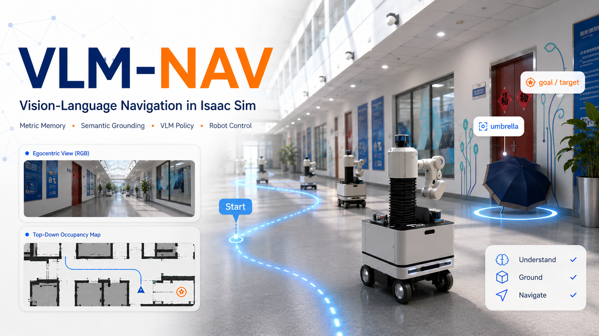
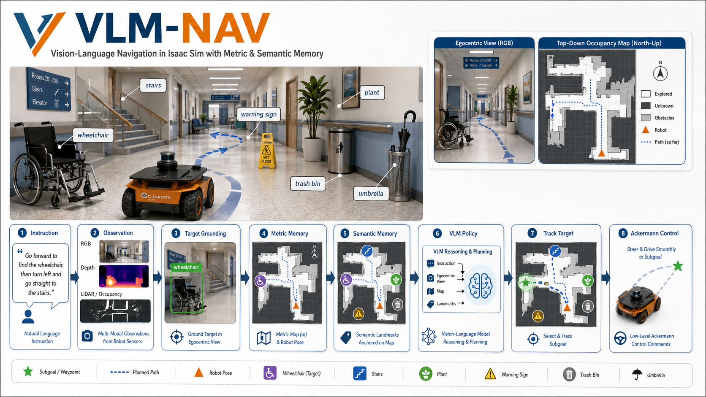

<div align="center">

# CAPTAINav

### Confidence-Gated Semantic Anchors and Primitive-Aligned Typed Instruction Navigation

Language-conditioned navigation in Isaac Sim with open-vocabulary grounding,
persistent semantic anchors, map-aware VLM reasoning, and robot-specific motion primitives.



</div>

## Demo

> **Instruction:** “You are currently in the hospital lobby. You need to go straight to
> find the wheelchair, then turn left, and in front of the stairs, turn right to find
> the yellow warning sign and stop in front of it.”

AGX first-view
<video src="docs/assets/agx_fv.mp4" controls="controls" width="500" height="300"></video>
AGX third-view
<video src="docs/assets/agx_tv.mp4" controls="controls" width="500" height="300"></video>
G1 first-view
<video src="docs/assets/g1_fv.mp4" controls="controls" width="500" height="300"></video>
G1 third-view
<video src="docs/assets/g1_tv.mp4" controls="controls" width="500" height="300"></video>
## Overview

CAPTAINav is a closed-loop VLN research prototype built on Isaac Sim 5.1. It combines:

- A validated typed instruction graph with `GO_TO`, `TURN`, and `REGION_TRANSITION`.
- GroundingDINO proposals with confidence-gated VLM semantic verification.
- RGB-D observations, LiDAR occupancy mapping, odometry, topology, and persistent landmark anchors.
- A clean first-person image plus structured textual map/candidate context for VLM decisions.
- Fixed semantic primitives shared by all robots: `FORWARD`, `TURN_LEFT`, and `TURN_RIGHT`.
- Robot-specific primitive realization and swept-footprint safety for AGX and Unitree G1.
- Separate local development and dataset evaluation flows.



## Method

```text
English instruction
  -> one fail-closed instruction parse
  -> validated route graph: GO_TO / TURN / REGION_TRANSITION
  -> stopped decision keyframe
       RGB-D observation
       GroundingDINO target proposals
       VLM verification for ambiguous proposals
       LiDAR global occupancy + topological memory
       persistent semantic landmark anchors
  -> primitive-aligned candidate table
  -> VLM selects one valid candidate/action
  -> DepthSafetyMonitor checks front/left/right RGB-D and LiDAR clearance
  -> AGX 4WS controller or Unitree G1 locomotion policy
  -> odometry-verified primitive completion
  -> next decision keyframe
```

### Instruction Execution

The instruction parser runs before Isaac Sim starts. It returns a strict semantic graph:

- `GO_TO`: find and approach one grounded landmark.
- `TURN`: perform a bounded directional turn, optionally at a semantic trigger.
- `REGION_TRANSITION`: leave or enter a region using semantic, odometric, and topological evidence.

Objects that only describe the initial scene remain context evidence and are not silently promoted
to navigation targets. Invalid LLM JSON receives one repair request; if the repaired graph is still
invalid and no matching cache exists, startup fails explicitly.

### Perception And Memory

GroundingDINO is required by the navigation path. At decision keyframes it proposes bounding boxes
for the current semantic target. High-confidence proposals can be accepted directly; ambiguous
proposals are verified by the VLM using a clean crop. Bbox depth is estimated from a robust depth
cluster inside the box, then projected through the centralized camera/robot/world transform.

Confirmed anchors remain in the landmark map after leaving the camera view or completing a route
step. A detector proposal without reliable geometry may guide visual search, but it cannot create
a world anchor or complete a landmark by itself.

### Candidate Decisions

The VLM does not receive the occupancy image. Its navigation request contains:

- A clean, uncropped first-person RGB frame.
- The current typed route step and progress history.
- Structured landmark and topology summaries.
- Candidate heading, distance, map reachability, and repetition cost.
- A concise capability description for the selected robot profile.

The occupancy image remains available in `debug/local/vln_debug.png` for human inspection.

### Robot-Aware Safety

`DepthSafetyMonitor` is the runtime obstacle-avoidance gate. It combines robust depth statistics
from front/left/right image regions with the corresponding LiDAR sector distances:

- `FORWARD` stops at the robot profile's obstacle threshold and slows in the near field.
- `TURN_LEFT` checks front and left clearance.
- `TURN_RIGHT` checks front and right clearance.
- A short near-field memory prevents one missing sensor frame from immediately clearing an obstacle.
- Repeated safety holds cancel the active primitive and invoke the existing recovery path.

Robot profiles retain scalar stop, map-inflation, and candidate-corridor radii. The experimental
polygon footprint and full primitive sweep are not part of the active navigation path.

## Requirements

| Component | Version |
|---|---|
| OS | Linux x86_64 |
| Python | 3.11 |
| Isaac Sim | 5.1.0 pip distribution |
| CUDA GPU | Required for Isaac Sim and GroundingDINO |
| VLM API | OpenAI-compatible endpoint; SiliconFlow is configured by default |

## Installation

### 1. Create The Environment

```bash
conda create -n vlmnav python=3.11 -y
conda activate vlmnav
python -m pip install --upgrade pip setuptools wheel
```

### 2. Install Isaac Sim And Core Dependencies

```bash
pip install -r requirements.txt
```

The requirements pin Isaac Sim 5.1 and `numpy==1.26.0`, together with Pillow, PyYAML, and OpenCV.

### 3. Install GroundingDINO

```bash
conda activate vlmnav

# Install a compatible PyTorch build if the environment does not already provide it.
pip install torch==2.7.0 torchvision==0.22.0 \
  --index-url https://download.pytorch.org/whl/cu128

bash scripts/setup_grounding_dino_local.sh
```

The current local paths are:

```text
third_party/GroundingDINO/
weights/grounded_sam/GroundingDINO_SwinT_OGC.py
weights/grounded_sam/groundingdino_swint_ogc.pth
weights/grounded_sam/bert-base-uncased/
```

The `weights/grounded_sam` directory name is retained only to avoid moving existing local weights;
the active method does not install or run SAM.

### 4. Configure The VLM

`configs/default.yaml` contains the endpoint, model name, and API-key field. The API key can also be
provided without editing the file:

```bash
export SILICONFLOW_API_KEY="your_api_key"
```

## Running

### Local Navigation

```bash
conda activate vlmnav
bash scripts/run_nav.sh
```

Common commands:

```bash
bash scripts/run_nav.sh --list-tasks
bash scripts/run_nav.sh --task hospital_002
bash scripts/run_nav.sh --headless
```

`scripts/run_nav.sh` uses the currently active conda environment. From an inactive shell:

```bash
CONDA_ENV_NAME=vlmnav bash scripts/run_nav.sh
```

### Robot Selection

Change only the profile name in `configs/default.yaml`:

```yaml
robot:
  profile: "agx"  # or "unitree_g1_29dof"
```

Robot-specific assets, sensors, physics rates, controller settings, primitive realization,
footprint, and safety limits live in:

```text
configs/robots/agx.yaml
configs/robots/unitree_g1_29dof.yaml
```

The semantic meaning of a primitive is shared, while its distance, angle, command magnitude,
timeout, and swept envelope come from the selected profile.

### G1 Policy Test

Validate the G1 TorchScript policy independently before running VLN:

```bash
bash scripts/run_g1_policy_test.sh
```

Use the arrow keys or panel buttons. Releasing all directions commands active zero-velocity
balance. The test automatically resets after a confirmed fall.

### Task Authoring

```bash
bash scripts/run_task_editor.sh
```

The Isaac Sim panel writes local tasks to `configs/instructions.json`. Task start `x`, `y`, and yaw
come from the task; spawn height comes from the selected robot profile.

## Evaluation

### InteriorNav

```bash
SPLIT=val_unseen EPISODE_INDEX=0 bash eval/interiornav/run.sh
```

### VLN-PE

```bash
SPLIT=val_unseen EPISODE_INDEX=0 bash eval/vlnpe/run.sh
```

Dataset adapters normalize source episodes into `eval/current_episode.json`. Evaluation artifacts
are written under `debug/eval/`, including a structured result JSON for each episode.

## Configuration

`configs/default.yaml` is a complete strict configuration. A custom YAML may contain only the
fields it overrides; it is deep-merged with the default file. Unknown fields are fatal instead of
being silently ignored.

```yaml
robot:
  profile: "unitree_g1_29dof"

scene:
  usd_path: "usd/hospital.usd"
  robot_start_xy_m: [1.5, 4.0]

llm:
  model_name: "Qwen/Qwen3-VL-30B-A3B-Instruct"
  timeout_sec: 30

perception:
  grounding:
    call_period_sec: 0.10
    detector:
      box_threshold: 0.45

navigation:
  progress:
    landmark_clearance_m: 1.0
    final_success_clearance_m: 2.0
```

Physical geometry and primitive parameters must be edited in the robot profile, not duplicated in
the global configuration.

## Outputs

```text
debug/
  local/
    vln_debug.png
    observevideos/observer_<timestamp>.mp4
    videos/vln_debug_<timestamp>.mp4
  eval/
    vln_debug.png
    videos/vln_debug_<timestamp>.mp4
    results/<episode>_<timestamp>.json

logs/
  nav_latest.log
  vln.log
```

`nav_latest.log` is the complete launcher/Isaac console capture. `vln.log` contains the CAPTAINav
logger stream. Both are overwritten on the next local run.

## Tests

Pure-code tests do not start Isaac Sim:

```bash
PYTHONPATH=src python -m unittest discover -s tests -v
```

They cover instruction validation, robot profiles, spatial projection, landmark evidence,
semantic turns, occupancy behavior, and robot-specific primitive safety.

## Limitations

- VLM latency remains the main delay between decision keyframes.
- Open-vocabulary detections can still be ambiguous despite confidence gating and crop verification.
- World anchors depend on camera calibration, depth quality, and odometry consistency.
- The Unitree G1 behavior depends strongly on the quality and deployment compatibility of its policy.
- CAPTAINav is a research prototype, not a safety-certified navigation system.

## Research Context

CAPTAINav draws on VLN, ObjectNav, open-vocabulary grounding, semantic memory, and map-aware robot
navigation. Related systems include R2R, VLN-CE, DUET, NavGPT, Safe-VLN, CA-Nav, and Open-Nav.
