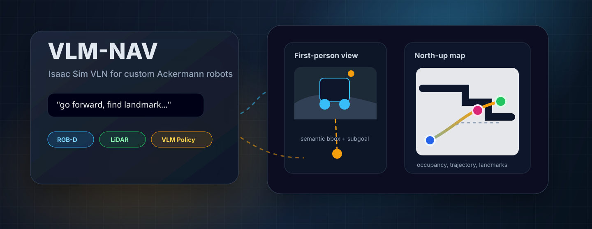
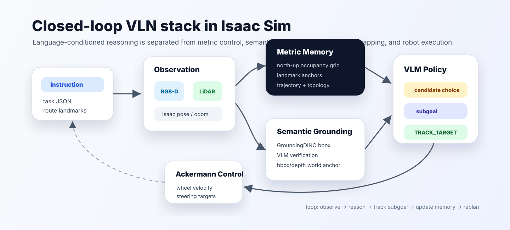

<div align="center">
  

  <h1>VLM-NAV</h1>

  <p>
    <b>Vision-language navigation in Isaac Sim for a custom Ackermann-style mobile robot.</b><br>
    Language instructions, RGB-D perception, LiDAR occupancy mapping, semantic grounding, VLM decision making, and low-level wheel/steering control in one runnable stack.
  </p>

  <p>
    
    
    
    
  </p>
</div>

## Overview

VLM-NAV is a research-oriented VLN/ObjectNav prototype built on **Isaac Sim 5.1**. It keeps the simulator, robot USD, RGB-D camera, LiDAR, odometry, and Ackermann joint-control pipeline in Isaac Sim, while the high-level navigation stack uses a VLM to choose local navigation subgoals from visual and map context.

The current main branch is intentionally focused on a clean closed loop:

```text
instruction -> observation -> candidates/map/grounding -> VLM decision -> TRACK_TARGET -> Ackermann controller
```

It is not a Habitat reproduction and does not require training a waypoint predictor. The goal is to make a custom robot move in a realistic Isaac Sim scene, expose the important intermediate signals, and provide a base for iterative VLN experiments.

## Highlights

- **Isaac Sim native runtime**: standalone Python entry point, USD scene loading, custom robot USD loading, front camera, observer camera, LiDAR, and odometry.
- **Language-conditioned navigation**: tasks are stored as JSON instructions with scene path and robot start pose.
- **Semantic landmark grounding**: GroundingDINO bbox, optional SAM hooks, VLM semantic verification, depth-based world anchor estimation, and landmark tracking.
- **Global occupancy memory**: LiDAR-based north-up occupancy map with robot trajectory, active subgoal, and confirmed/completed landmarks.
- **Continuous subgoal tracking**: current default mode uses `TRACK_TARGET` for normal navigation subgoals instead of repeatedly executing short discrete primitives.
- **Ackermann-aware low-level control**: wheel velocity and steering position targets are sent through the existing robot articulation chain.
- **Debug-first design**: a single human-facing debug image plus timestamped MP4 videos are generated for post-run analysis.

## Method

<p align="center">
  
</p>

The stack separates four concerns:

1. **Metric memory**: LiDAR and odometry update a global occupancy map. The map is rendered north-up so the VLM sees route context rather than only an egocentric crop.
2. **Semantic memory**: target detections are grounded in the RGB image, verified semantically, projected into the world frame with depth, and stored as landmark anchors after consistency checks.
3. **VLM policy**: the VLM receives the instruction, first-person view, global map, candidate actions, landmark state, and safety context, then selects a local target.
4. **Robot execution**: selected subgoals are tracked continuously with Ackermann-friendly wheel/steering commands. Safety and stuck monitors can interrupt execution and request replanning.

## Repository Layout

```text
.
├── configs/
│   ├── default.yaml              # runtime, perception, control, map, and debug config
│   └── instructions.json         # navigation task list
├── docs/assets/
│   ├── vlm_nav_hero.svg          # README hero graphic
│   └── method_overview.svg       # README method diagram
├── exts/vln.nav.task_editor/     # Isaac Sim UI extension for creating new tasks
├── scripts/
│   ├── run_nav.sh                # main navigation launcher
│   ├── run_task_editor.sh        # Isaac Sim task authoring panel
│   ├── setup_grounded_sam_local.sh
│   └── test_llm_call.py          # isolated LLM/prompt test
├── src/
│   ├── ros2_car_model_ws/        # custom robot USD assets
│   └── vln_nav/
│       ├── app/nav.py            # main Isaac Sim loop
│       ├── control/controller.py # Ackermann wheel/steering control
│       ├── navigation/           # perception, memory, policy, planner, grounding
│       └── runtime/              # config, Isaac helpers, video writer
├── third_party/GroundingDINO/    # optional local detector checkout
├── usd/                          # scene USD files
└── weights/grounded_sam/         # GroundingDINO/SAM weights
```

## Requirements

- Ubuntu/Linux workstation with NVIDIA GPU.
- Conda environment named `env_isaaclab`.
- Python 3.10.
- Isaac Sim 5.1 installed in the conda environment.
- A SiliconFlow/OpenAI-compatible VLM API key.
- Optional but recommended: GroundingDINO checkpoint for local semantic grounding.

The project assumes the existing conda environment:

```bash
conda activate env_isaaclab
```

If Isaac Sim is not installed yet, install it in that environment using NVIDIA's official Isaac Sim 5.1 Python package workflow.

## Quick Start

Set the API key through an environment variable instead of hard-coding it in config:

```bash
export SILICONFLOW_API_KEY="your_api_key"
```

Run the default task:

```bash
bash scripts/run_nav.sh
```

List available tasks:

```bash
bash scripts/run_nav.sh --list-tasks
```

Run a specific task:

```bash
bash scripts/run_nav.sh --task hospital_002
```

Run headless:

```bash
bash scripts/run_nav.sh --headless
```

If non-headless Isaac Sim starts but no GUI appears, the renderer is usually bound to a GPU without display output. The config uses `sim.active_gpu: auto`; you can override it:

```bash
ACTIVE_GPU=1 bash scripts/run_nav.sh
```

## Task Format

Navigation tasks live in `configs/instructions.json`. Each task defines a scene, robot start pose, and natural-language instruction:

```json
{
  "id": "hospital_001",
  "scene_usd_path": "usd/environment/hospital_flat.usd",
  "robot_start_position": [1.5, 4.0, 0.0],
  "robot_start_orientation_deg": [0.0, 0.0, 0.0],
  "instruction": "向前走找到轮椅，然后左转再直走找到楼梯"
}
```

`robot_start_position[2]` is the `/World/Robot` root prim z value. In the current setup it should normally stay `0.0`; do not treat it as wheel-ground contact height.

## Creating New Tasks

Use the built-in task editor when you want to author a new start pose visually:

```bash
bash scripts/run_task_editor.sh
```

The script opens Isaac Sim, loads the configured scene and robot, and shows a `VLM-NAV Task Editor` panel. Move `/World/Robot` in the viewport, enter a task id and instruction, then save. The panel writes only to `configs/instructions.json`; it does not save changes back into the scene USD unless you explicitly use Isaac Sim's own file-save commands.

The scene and robot used by the editor are defined at the top of `scripts/run_task_editor.sh`.

## GroundingDINO / SAM Setup

The default grounding backend is:

```yaml
target_grounding:
  backend: "auto"
```

In `auto` mode the system tries local GroundingDINO first and falls back to VLM bbox grounding if the detector is unavailable.

Expected local paths:

```text
third_party/GroundingDINO/
weights/grounded_sam/GroundingDINO_SwinT_OGC.py
weights/grounded_sam/groundingdino_swint_ogc.pth
```

Set up the local files:

```bash
bash scripts/setup_grounded_sam_local.sh
```

If you already have CA-Nav compatible weights, symlink them:

```bash
ln -sf /home/Lab/qiangsibin/CA-Nav-code/data/grounded_sam/GroundingDINO_SwinT_OGC.py weights/grounded_sam/GroundingDINO_SwinT_OGC.py
ln -sf /home/Lab/qiangsibin/CA-Nav-code/data/grounded_sam/groundingdino_swint_ogc.pth weights/grounded_sam/groundingdino_swint_ogc.pth
```

SAM is currently optional and disabled by default:

```yaml
target_grounding:
  sam_enabled: false
```

To enable SAM later, provide a checkpoint such as:

```text
weights/grounded_sam/sam_vit_h_4b8939.pth
```

## Key Configuration

Most knobs are in `configs/default.yaml`.

```yaml
llm:
  api_base_url: "https://api.siliconflow.cn/v1"
  model_name: "Qwen/Qwen3-VL-30B-A3B-Instruct"
  timeout_sec: 30

control:
  use_discrete_action_primitives: false  # false = continuous TRACK_TARGET
  wheel_drive_velocity: 14.0
  steering_angle: 0.65
  track_min_speed_scale: 0.45
  track_max_speed_scale: 1.0

occupancy_grid:
  enabled: true
  resolution_m: 0.08
  size_m: 80.0
  lidar_bootstrap_min_fov_deg: 165.0
  semantic_planner_enabled: true

lidar:
  enabled: true
  mode: "single"
  horizontal_fov_deg: 180.0
  max_range_m: 10.0

target_grounding:
  enabled: true
  backend: "auto"
  call_period_sec: 1.5
  semantic_verification_enabled: true

opennav:
  arrival_distance_m: 1.4
  success_distance_m: 2.0
  debug_video_enabled: true
```

To switch back to fully discrete primitive execution:

```yaml
control:
  use_discrete_action_primitives: true
```

## Debug Outputs

Runtime outputs are intentionally concentrated:

```text
logs/nav_latest.log
debug/vln_debug.png
debug/videos/vln_debug_YYYYMMDD_HHMMSS.mp4
debug/llm_request.png
logs/last_candidate_choice_request.json
```

- `debug/vln_debug.png`: human-facing view. Left side is the north-up occupancy map; right side is first-person target/subgoal visualization.
- `debug/videos/vln_debug_YYYYMMDD_HHMMSS.mp4`: timestamped MP4 recording of the debug panel, suitable for VSCode playback.
- `debug/llm_request.png`: the actual image sent to the VLM during replanning. It combines the global map and first-person candidate view.
- `logs/nav_latest.log`: control, grounding, landmark, safety, and policy decisions.
- `logs/last_candidate_choice_request.json`: latest VLM candidate-choice request for offline prompt debugging.

Test the latest navigation prompt without launching Isaac Sim:

```bash
python scripts/test_llm_call.py
```

Or manually test an image:

```bash
python scripts/test_llm_call.py --mode manual --image debug/llm_request.png
```

## Main Runtime Chain

1. `src/vln_nav/app/nav.py` launches Isaac Sim and loads the scene, robot, cameras, LiDAR, and controller.
2. `observation_adapter.py` packages RGB, depth, robot pose, and execution feedback.
3. `lidar_sensor.py` and `occupancy_grid.py` maintain the global occupancy map.
4. `target_grounding.py`, `target_tracker.py`, `landmark_tracker.py`, and `landmark_map.py` maintain semantic landmark state.
5. `candidate_waypoint_predictor.py` and `map_candidate_generator.py` build local action/subgoal candidates.
6. `vln_reasoner.py` sends the instruction, map, image, candidates, memory, and safety context to the VLM.
7. `vln_policy.py` converts the decision into either a continuous `TRACK_TARGET` subgoal or, if explicitly configured, a discrete action primitive.
8. `control/controller.py` applies wheel velocity and steering targets to the robot articulation.

## Current Scope

This repository is a working research prototype, not a polished benchmark implementation. Current priorities are:

- robust custom-robot execution in Isaac Sim;
- readable debug artifacts;
- global metric memory for avoiding dead ends;
- semantic landmark memory for multi-step instructions;
- controlled iteration on VLM prompts and candidate generation.

Known limitations:

- landmark grounding can still produce false positives in visually ambiguous hospital scenes;
- world anchors depend on camera/depth geometry quality;
- VLM decisions are latency-bound by the configured API endpoint;
- continuous tracking is smoother than short primitives, but still relies on local map quality and safety interruption.

## Citation / Acknowledgement

This project is inspired by recent VLN and open-vocabulary navigation systems that combine language-conditioned reasoning, visual grounding, topological or metric memory, and local control. It adapts those ideas to an Isaac Sim custom-robot workflow rather than a Habitat benchmark pipeline.
